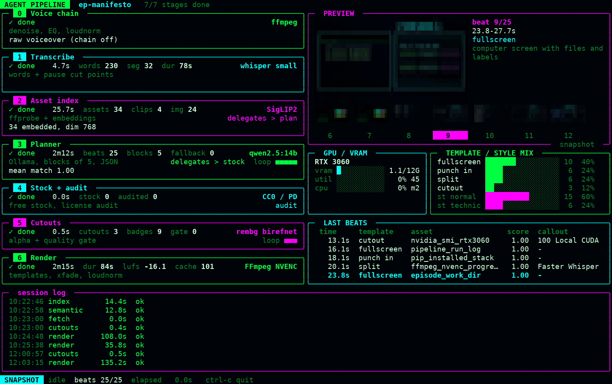
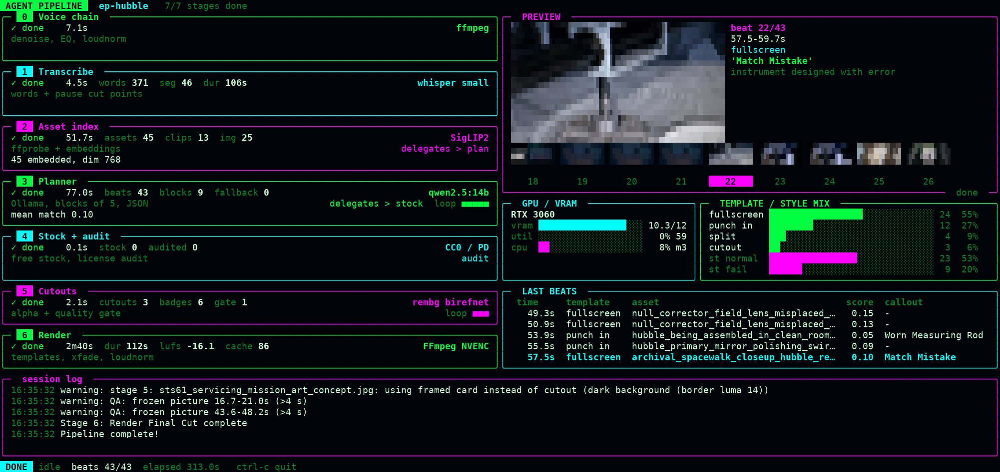
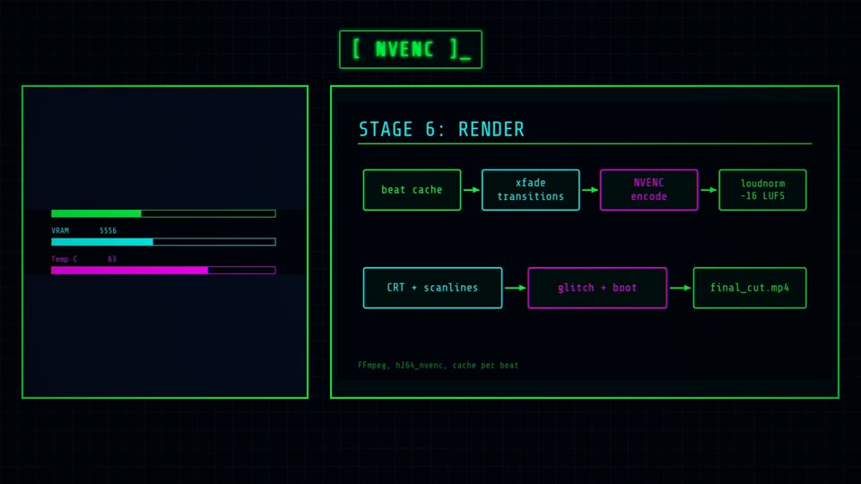

# Psycho Astronaut: local video pipeline

**Voice-over in, edited 1080p cut out. Fully local, no cloud, CC0/public-domain media.**

Psycho Astronaut is an open-source, command-line pipeline that turns a narration plus a folder of
footage, photos and diagrams into a finished engineering-style YouTube video (brisk cuts,
schematics for invisible mechanics, cut-outs with short labels, punch-ins on failures).
Transcription, planning, matching and rendering all run on your machine: faster-whisper, Ollama,
SigLIP2, rembg and FFmpeg. Stock media is optional and limited to CC0/public-domain sources by
default, with a license audit for every download.



A full run on the Hubble example episode (43 beats, 2m40s render on an RTX 3060, `dashboard --run`):




```
voiceover ─▶ 0 voice ─▶ 1 transcribe ─▶ 2 index ─▶ 3 plan ─▶ 4 stock ─▶ 5 cutouts ─▶ 6 render
             chain       Whisper         SigLIP2    Ollama    audit      rembg        FFmpeg
```

## Features

| Stage | What it does |
|---|---|
| 0 Voice chain | FFmpeg-only clean-up: highpass, denoise, gate, EQ, de-esser, compressor, long-silence shortening, limiter, 2-pass loudnorm (-16 LUFS). Presets `podcast`, `gentle`, `aggressive` |
| 1 Transcribe | faster-whisper (CUDA, CPU fallback) with word timestamps and pause-based cut points |
| 2 Index | ffprobe + sidecar `.txt` hints; semantic index (SigLIP2, or Ollama `qwen2.5vl` + `nomic-embed-text`); optional Real-ESRGAN upscale of small photos; vidstab stabilization of shaky clips; letterbox (black bar) detection and crop |
| 3 Plan | Deterministic cuts on pauses + a local LLM (Ollama, JSON-schema output, blocks of 5 beats) that picks templates, styles, callouts and assets; global asset assignment with reuse caps; falls back to a deterministic planner per block |
| 4 Stock | Optional free stock (NASA, Wikimedia Commons, Openverse CC0/PDM, Internet Archive, Smithsonian; Pexels/Pixabay with a key) with visual verification and `licenses_audit.json` |
| 5 Cutouts | rembg (`birefnet-general-lite`, fallback isnet/u2net), alpha clean-up, quality gate that swaps a bad cut-out for a framed card; badges and lower-thirds |
| 6 Render | One FFmpeg encode per beat (cached), xfade transitions, perspective-warp camera moves, NVENC with x264 fallback, 2-pass loudnorm, QA gate, `--draft` preview |
| Dashboard | `dashboard` draws a live "AGENT PIPELINE" TUI (rich + PIL): stage state, GPU/VRAM, template mix, frame preview; can record or snapshot |
| `new` | Scaffolds an episode folder with a lean config, checklist and a documented sidecar template |

## Requirements

- Python 3.11+ (developed on 3.14)
- `ffmpeg` and `ffprobe` (NVENC optional; libx264 is used otherwise; libvidstab optional)
- [Ollama](https://ollama.com) with a text model for planning (default `qwen2.5:14b-instruct`;
  `qwen2.5:7b-instruct` or `3b` work with lower quality). For the Ollama semantic backend also
  `qwen2.5vl:3b` and `nomic-embed-text`
- GPU with 8-12 GB VRAM recommended (developed on an RTX 3060 12 GB). CPU works but is slow
- Optional extras: `[semantic]` (torch, transformers, scenedetect, opencv: SigLIP2 backend),
  `[upscale]` (torch, spandrel, einops: Real-ESRGAN)

## Install

```bash
git clone <this repo> videomaker && cd videomaker
uv venv && uv pip install -e '.[dev,semantic,upscale]'     # or: python -m venv .venv && .venv/bin/pip install -e '.[dev,semantic,upscale]'
cp .env.example .env                                       # optional API keys / LLM overrides
ollama pull qwen2.5:14b-instruct
```

Run commands with `python -m src.cli ...` from the repo root (the `videomaker` script is the
same app). Model weights (Whisper, SigLIP2, rembg, Real-ESRGAN) download on first use.

## Quickstart

```bash
python -m src.cli new ep-demo --template blank                # 1. scaffold episodes/ep-demo/
# 2. put footage in raw/clips, photos in raw/images, diagrams in raw/schematics,
#    and the narration in episodes/ep-demo/raw/voiceover.wav (see docs/ASSETS.md)
python -m src.cli audio ep-demo --report                      # 3. clean the voice-over
python -m src.cli --config episodes/ep-demo/config.yaml run ep-demo   # 4. full pipeline
python -m src.cli --config episodes/ep-demo/config.yaml dashboard ep-demo --run   # 5. or: run with the live dashboard
```

Output: `episodes/ep-demo/out/final_cut.mp4`, `timeline_summary.md`, `licenses_audit.json`,
`qa_report.json`. No footage yet? `python -m src.cli create-demo ep-demo` builds a synthetic
episode. Full walkthrough: [docs/USAGE.md](docs/USAGE.md).

## Templates and beat styles

| Visual template | Use |
|---|---|
| `fullscreen_clip` | Clip or photo (drift/pan) full frame |
| `punch_in_emphasis` | Fast zoom on a failure or key moment |
| `split_schematic` | Footage panel (640 px) plus a legible diagram panel |
| `cutout_callout` | Subject cut-out over a blurred background with a short label |

| Beat style | Look |
|---|---|
| `normal` | Default drift |
| `deadpan` | Static, crossfades |
| `hype` | Faster moves, hard/glitch cuts |
| `technical` | Cyan accents, stable, dissolves |
| `fail` | Red accent, micro-punch, hard/glitch cuts |

Episode creation templates for `new`: `blank`, `tutorial` (screen recordings), `diy` (bench footage).

## Known limitations

- Matching is moderate. On a hand-labelled 47-beat episode the exact intended asset was picked
  about 20-35 % of the time and an acceptable one about 45-65 % (run-to-run noise of several points).
  Review `out/timeline_summary.md`, which flags low-score beats, and edit `scene_plan.json`.
- Cut-outs sometimes fall back to framed cards; callouts are sometimes weak.
- `split_schematic` appears only when a diagram passes the legibility rule; small diagrams never do.
- Text-model quality depends on the Ollama model; 3b models plan poorly.
- Tested on Linux with one GPU. Windows/macOS are untested.

## Licenses and media policy

- Code: MIT ([LICENSE](LICENSE)).
- Media policy: stock fetching uses CC0/public-domain sources by default. Pexels/Pixabay are used
  only if you provide a key and leave `stock_media.strict_cc0_only: false`; their licenses are not
  CC0 and are flagged "free-license (non-CC0)" in the timeline. Set `strict_cc0_only: true` to
  forbid them and `stock_media.enabled: false` for local assets only. You are responsible for the
  rights to your own footage, and for checking `licenses_audit.json` before publishing.

## Third-party credits

| Component | License |
|---|---|
| faster-whisper / Whisper models | MIT |
| SigLIP2 (`google/siglip2-*`) via transformers | Apache-2.0 |
| rembg; BiRefNet / IS-Net / U2-Net weights | MIT / Apache-2.0 |
| Real-ESRGAN x4plus (via spandrel) | BSD-3-Clause |
| PySceneDetect, OpenCV | BSD-3-Clause / Apache-2.0 |
| Ollama and Qwen2.5 / Qwen2.5-VL, nomic-embed-text | MIT (Ollama), Apache-2.0 or Qwen license depending on size: check each model card |
| FFmpeg (and libvidstab) | LGPL/GPL, called as an external program |
| Share Tech Mono, VT323 fonts | SIL OFL 1.1 (`assets/fonts`) |

Model weights keep their own licenses; verify them for your use.

## Roadmap

- Better asset matching (more labelled episodes, stronger rerank)
- Background music (CC0) with sidechain ducking
- Animated diagrams; per-word alignment
- Fewer cut-outs falling back to cards; better callouts

## Contributing

See [docs/CONTRIBUTING.md](docs/CONTRIBUTING.md). Docs: [USAGE](docs/USAGE.md) |
[ASSETS](docs/ASSETS.md) | [CONFIG](docs/CONFIG.md) | [ARCHITECTURE](docs/ARCHITECTURE.md) |
[TROUBLESHOOTING](docs/TROUBLESHOOTING.md) | [CHANGELOG](CHANGELOG.md)

## Support

If the pipeline helped you, you can buy me a coffee:

[](https://buymeacoffee.com/rodrigomcaq)
