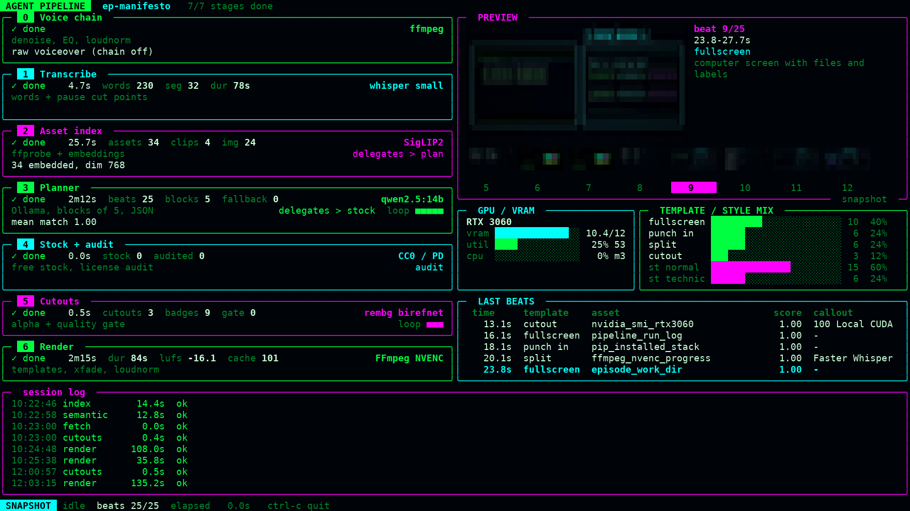

# Usage

All commands run from the repo root. `--config` is a global option and goes BEFORE the command.
An episode `config.yaml` is deep-merged over `config/default.yaml` (list only overrides).

```bash
python -m src.cli --config episodes/<ep>/config.yaml <command> <ep>
```

## 1. Create the episode

```bash
python -m src.cli new --list-templates
python -m src.cli new my-ep --template diy --theme psycho_terminal --no-stock
```

`new` options: `--template/-t blank|tutorial|diy`, `--theme`, `--stock/--no-stock`
(`stock_media.enabled`), `--from <ep>` (copy another episode's `config.yaml`), `--force` (fill in
missing files of an existing folder). It creates `raw/{clips,images,schematics}`, `raw/voiceover/`,
`raw/script.txt`, `raw/_TEMPLATE.txt.example`, `work/`, `out/`, `config.yaml` and a checklist
`README.md`. Only `clips`, `images`, `schematics` are scanned by Stage 2.

## 2. Add assets and the voice-over

Put media and sidecars in `episodes/my-ep/raw/` (see [ASSETS.md](ASSETS.md)) and the narration as
`raw/voiceover.wav` (also `.mp3/.m4a/.flac`). Optional script: `raw/script.md` or `raw/script.txt`
(used for entity detection and stock prefetch).

## 3. Voice chain (Stage 0)

```bash
python -m src.cli audio my-ep --report            # before/after numbers (see below)
python -m src.cli audio my-ep --preset podcast    # natural (default) | podcast | gentle | aggressive
python -m src.cli audio my-ep --ab                # work/audio_ab/: listen and compare
```

The original is kept as `raw/voiceover.orig.*`; the result is `work/voiceover_clean.wav`
(mono, 48 kHz). Timings downstream refer to the shortened audio. All local.

Preset `natural` (default) keeps the timbre of the real microphone: no 250 Hz mud cut, +1 dB
presence, +1.5 dB air shelf (8 kHz) to give back what denoise takes, 2:1 compression, expander
limited to 10 dB, RNNoise mix 0.45 (at strength 0.6), afftdn 8 dB, and notches inside the voice
zone (85-1000 Hz) capped at -9 dB, narrow, and only for lines 12+ dB over the floor (a deep
notch near the fundamentals/harmonics tints the voice and sounds like an old radio). Measured on
ep-hubble vs the original (speech frames, level-matched): all bands within ~1.6 dB, no hole
deeper than 4 dB, floor 48 dB under the voice (`podcast`: 51 dB, 2-3 dB tonal loss per band).
`podcast`/`gentle`/`aggressive` keep their older, heavier settings.

Chain: highpass -> automatic notches -> denoise (afftdn, then RNNoise) -> soft downward
expander -> EQ -> de-esser -> compressor (no makeup) -> silence shortening -> limiter ->
2-pass loudnorm. The only gain stage is the last one, so residue is never boosted by an earlier
stage and the expander threshold is set from the measured, already denoised floor.

* Noise analysis: the quietest frames (50 ms RMS) are used as pure-noise segments; their mean
  spectrum is searched for narrow lines (hum, fan, whine at ANY frequency, harmonics included).
  Each line gets a narrow `equalizer` notch (width ~ the measured line, up to -26 dB). Found
  lines are listed in `work/audio_report.json` (`noise_analysis.tonal_peaks`, `notch_filters`).
  `audio.notch: auto | off | [Hz, ...]` (a list forces those frequencies; forced lines in the voice
  zone are also depth-capped by the preset).
* Denoise `audio.denoise: auto | rnnoise | afftdn | off`, `audio.denoise_strength` 0..1
  (default 0.6). `auto` = (a) `afftdn` whose noise level is calibrated on the longest
  pure-noise clip of this file, then (b) `arnndn` (RNNoise) at a conservative mix
  (0.65 x strength). The RNNoise model (`sh.rnnn`, "somnolent-hogwash" from
  GregorR/rnnoise-models, no copyright claimed) is downloaded once to
  `~/.cache/videomaker/models`; offline or on failure the chain silently uses afftdn only.
  `audio.rnnoise_model` points at another `.rnnn`. DeepFilterNet is not wired in (its pip
  package pins old torch and a Rust build; it would risk the environment): if you want it,
  run it yourself on `raw/voiceover.orig.*` and use the result as the source.
* Expander: `agate` as a soft downward expander (ratio 2.5, 15 ms attack, 300 ms release,
  knee 2.5, reduction limited to `audio.expander_db`, default 14 dB), threshold
  `audio.expander_margin_db` (12) above the denoised floor. It lowers the residue between words,
  it never mutes it.
* Loudness: `audio.target_lufs` (-16) is measured on the mono file (a dual-mono stereo source
  reads 3 LU higher than the same samples as mono; plain `-ac 1` would also add 3 dB, so the
  downmix is a unity-gain `pan`).
* `--report` / `work/audio_report.json` (`verification`): noise floor in absolute dBFS and
  relative to the voice (p90 of frame levels), SNR, energy of each tonal peak before/after
  (absolute and relative to the voice), and the 300-4000 Hz speech energy change in voiced
  frames after notches + denoise + expander (should stay within about 1 dB).
* `--ab` writes `work/audio_ab/original.wav`, `atual.wav` (legacy chain), `podcast.wav` (previous
  default preset) and `novo.wav` (configured preset, `natural` by default): three
  10 s excerpts with voice and a pause each (same timeline, 1 s apart, level matched, silence
  shortening off so they line up), `spectrogram_{original,atual,novo}.png` and `ab.json`
  with the excerpt start times.
* Tuning: if the voice sounds watery or "chirpy", lower `denoise_strength` (try 0.4); if noise
  is still audible, raise it (0.8) or use `--preset aggressive`.

## 3b. Music (Stage 5b)

```bash
python -m src.cli music my-ep --preview                 # work/music.wav + work/music_preview.wav (20 s voice + music)
python -m src.cli music my-ep --source synth --mood calm
```

Hides voice-over noise with a quiet track. Sources (`music.source`, `auto` = first that works):
`episode` (`raw/music/*`; the sidecar `<file>.txt` must say `license: CC0` and may give `author:`,
`url:`), `library` (`assets/music/*`, same sidecars), `openverse` (CC0 / public-domain audio
>= 60 s via the Openverse API, then Internet Archive and Wikimedia Commons when the licence is
exactly CC0/PD; cached in `~/.cache/videomaker/music`), and `synth` (`src/music_synth.py`: dark
ambient/synthwave, 80-100 BPM, minor modes, deterministic per episode; always available, the
fallback when offline). CC-BY / CC-BY-SA / NC and Pixabay Music are never used;
`stock_media.strict_cc0_only: true` also refuses PD-mark and undeclared sidecar licences.
`music.mood`: `tense|calm|upbeat|auto` (auto reads the plan's `beat_style` mix).

At render the track (looped/cross-faded over intro + voice + outro, normalised to
`music.level_lufs`, default -29) starts low on the boot intro (`intro_gain`) and is lowered by
`duck_db` (6) under speech with a smooth gain curve computed from the voice envelope
(`work/music_ducked.wav`, no sidechain): speech gaps shorter than `hold` (2 s) never release the
music, so it does not pump between phrases; only longer pauses let it rise (raised-cosine
`release` 2.5 s, `attack` 0.25 s, `volume_in_pauses` dB extra). The track is also EQ-carved before levelling (`carve_db` -4 dB over `carve_lo`..`carve_hi`, 200-3000 Hz)
to leave room for the voice; the synth keeps its pad/arp low in that band. Then fades in/out, limiter; the voice
stays at -16 LUFS. `qa_report.json` gets a `music` block (voice, music and final LUFS; music
must stay 18 dB under the voice in speech (energy pooled over speech frames); `pumping_db` = largest gain swing in any 1 s window
outside intro/outro, about 3 dB at most; else a QA issue). `music.enabled: false` or
`source: off` disables it; `run` creates the track before the render (Stage 5b, skipped while up
to date); `--draft` renders without music. Source, author and licence land in
`work/music_audit.json` and `out/licenses_audit.json` (`music`).

## 4. Run the pipeline

```bash
python -m src.cli --config episodes/my-ep/config.yaml status my-ep
python -m src.cli --config episodes/my-ep/config.yaml run my-ep
python -m src.cli --config episodes/my-ep/config.yaml run my-ep --force            # re-run every stage
python -m src.cli --config episodes/my-ep/config.yaml run my-ep --from-stage plan  # skip stages before
```

`--from-stage` takes `audio|transcribe|index|semantic|prefetch|plan|fetch|cutouts|render`. `run` skips stages whose inputs did not change.

Single stages (always executed): `transcribe [-f]`, `index`, `semantic`, `upscale [-f]`,
`stabilize [-f] [--all]`, `prefetch`, `plan [-f]`, `fetch`, `cutouts`, `render`.

## 5. Plan: review and edit

```bash
python -m src.cli inspect my-ep plan          # also: transcript | assets | licenses
python -m src.cli plan my-ep --force          # regenerate; backs up a hand-edited plan first
```

`work/scene_plan.json` is the source of truth. Edit it by hand (fields in
[ARCHITECTURE.md](ARCHITECTURE.md#scene-plan-schema)), then `render`. A hand-edited plan is
never overwritten by `run` or `plan` without `--force`. Read `out/timeline_summary.md` to find
low-score beats.

## 6. Render

```bash
python -m src.cli --config episodes/my-ep/config.yaml render my-ep --draft   # out/draft.mp4, 640x360, fast
python -m src.cli --config episodes/my-ep/config.yaml render my-ep           # out/final_cut.mp4
```

Unchanged beats come from `work/render_cache`; editing one beat re-renders only that beat. Each
render writes `out/qa_report.json`.

## 7. Evaluate matching

```bash
python -m src.cli eval-matching my-ep --backend all          # baseline | siglip | ollama | all
python -m src.cli eval-matching my-ep --pairs path/to/pairs.json
```

Needs `work/local_assets.json` and labelled pairs (default `tests/semantic/pairs_<ep>.json`).

## 8. Dashboard

```bash
python -m src.cli --config episodes/my-ep/config.yaml dashboard my-ep --run                  # run + live TUI
python -m src.cli --config episodes/my-ep/config.yaml dashboard my-ep --run --force --from-stage plan
python -m src.cli --config episodes/my-ep/config.yaml dashboard my-ep --run --record out.cast --snapshot-at-end end.png
python -m src.cli --config episodes/my-ep/config.yaml dashboard my-ep --follow               # attach to a running run/render
python -m src.cli --config episodes/my-ep/config.yaml dashboard my-ep --replay --speed 2 --video
python -m src.cli --config episodes/my-ep/config.yaml dashboard my-ep --snapshot snap.png --size 140x44 --theme psycho
```

- `--theme slate|psycho`; `--snapshot` writes `.svg|.png|.txt` without a terminal.
- `--preview auto|kitty|iterm|sixel|blocks|quadrants`: real images in Kitty/iTerm2/sixel (chafa)
  terminals, otherwise character blocks. Example: `--preview kitty`.
- Ctrl-C stops the pipeline cleanly (exit 130); the pipeline's exit code is propagated.

### Dashboard preview quality

The preview panel adapts to the terminal (`--preview auto`, the default):

| Terminal | Mode | Result |
|---|---|---|
| Kitty, Ghostty | `kitty` | Full-resolution image of the current beat inside the panel |
| iTerm2, WezTerm | `iterm` | Full-resolution image (re-sent on each refresh) |
| Any terminal with `chafa` | `sixel` | Sixel image |
| Anything else, tmux, no tty | `quadrants` | 2x2 pixels per character cell (blocky, works everywhere) |

`--record` and `--snapshot` files (`.cast`, `.png`, `.svg`, `.txt`) always use the character-cell
renderer, because terminal graphics escapes cannot be stored in them. The live screen keeps the
detected protocol. Force a mode with `--preview kitty` (or `quadrants`, `blocks`).

Character-cell fallback (`quadrants`), 160x45 snapshot:



Inside tmux the graphics protocols are disabled by default; run the dashboard in a plain Kitty
window for full resolution.


## Fix mode (agentic point corrections)

`fix` edits `work/scene_plan.json` from a plain-language instruction (PT or EN). A local LLM
(Ollama `/api/chat` with a JSON schema; the model from `llm.model`) only fills an action list;
code locates the beat, picks assets from the SigLIP/semantic index, validates, shows a diff and
asks before writing. 100% local; no network. If Ollama is down it stops with a clear message.

```bash
python -m src.cli --config episodes/ep-hubble/config.yaml fix ep-hubble \
  "no 0:08 aparece um clipe de 2009 com legenda, troque por algo do Hubble sendo liberado"
python -m src.cli ... fix ep-hubble "remova esse clipe do projeto inteiro" --yes
python -m src.cli ... fix ep-hubble "no 0:30 dê zoom no canto superior esquerdo" --dry-run
python -m src.cli ... fix ep-hubble --interactive     # several fixes, `undo`, `render`, `quit`
python -m src.cli ... fix ep-hubble --review [--apply] [--scan-text]
```

* Actions: `replace_asset` (by name or by semantic query; top-k outside the bad asset, avoiding
  assets used nearby), `exclude_asset` (project-wide), `change_template`, `set_crop`/`set_zoom`
  (`crop_region`, stills and clips), `set_trim`, `set_callout`/`remove_callout`,
  `set_transition`, `split_beat`/`merge_beats`, `move_overlay` (PiP corner), `remove_highlight`.
* Locating the beat: final-video time ("no 0:08": plan time + the branding intro card; silence
  removal already happened in the voice chain, so the plan timeline is the narration timeline),
  narration time, a spoken quote ("quando eu falo 1990"), a beat id, or an asset. "esse clipe"
  refers to the asset the previous fix touched (`work/fix_log.jsonl`).
* Safety: diff first (beat, time, speech, before -> after), `--yes` to skip the prompt,
  `--dry-run` to only look. Backup `work/scene_plan.prev.json`, undo stack `work/fix_undo/`,
  log `work/fix_log.jsonl`. The plan is marked hand-edited, so `run` never overwrites it
  (`plan --force` regenerates). Only local, already-licensed assets are chosen; stock is never
  fetched and the fix render runs with `VIDEOMAKER_OFFLINE=1`.
* Exclusion: `exclude: true` is appended to the asset's sidecar `.txt` and the id is listed in
  `work/excluded_assets.json`. Stages 2, 2a and 3 and the semantic retrieval skip such assets;
  every beat that used it is re-assigned in the same fix.
* After applying, only the changed beats are re-rendered (`work/render_cache`), a before/after
  contact sheet is written to `work/fix_preview.png`, and the video path is printed.
  `--no-render` edits the plan only.
* `--review`: per beat, takes a frame of the beat's asset, asks the VLM (`qwen2.5vl:3b`)
  whether it fits the speech and whether there is burned-in text (subtitle, watermark, a year
  the narration does not say), and flags highlights that have no real position. Suspects are
  listed with a reason and a proposed fix (`work/fix_review.json`); `--apply` applies them
  after confirmation. `--scan-text` scans every asset and records `burned_text` in
  `local_assets.json` / `work/burned_text.json`; the planner then avoids those assets (or crops
  a thin caption band away via `crop_box`).

### Automatic diagram highlights

A highlight box is drawn only when its position is real: an explicit `highlight:` line in the
sidecar, or a box found by local OCR (optional `easyocr` / `pytesseract`) or by the VLM and
validated by reading the cropped region back, and in both cases matching the narration. Boxes
are padded, never cover the title/caption band and are capped at 30 % of the picture. No
reliable location means no highlight. Old plans with a bare `region: top|bottom` highlight are
skipped at render time (warning `highlight skipped`).

## Polish (editing rules)

```bash
python -m src.cli --config episodes/my-ep/config.yaml polish my-ep --dry-run   # table of changes only
python -m src.cli --config episodes/my-ep/config.yaml polish my-ep             # apply to work/scene_plan.json
```

`polish` applies the editing rules to an EXISTING plan (the same rules run inside `plan`/`run`
for new plans). It prints a readable diff (beat, rule, change, beats and transitions before/after,
diagram seconds shown vs needed), saves `work/scene_plan.prev.json`, marks the plan hand-edited
(like `fix`) and keeps the total duration and contiguity: only boundaries move or beats merge.

* Transitions: no sideways moves (`slideleft`, `smoothleft`, `wipeleft` become `crossfade`, or
  `dissolve` on technical beats); only cut, fade/dissolve/crossfade, fadeblack (and zoomin). The
  renderer also maps them to a crossfade unless `allow_motion` is passed to `resolve_joins`.
  Glitch joins stay only when `render.glitch_transitions` is on.
* Reading time: a beat with a diagram stays up `max(3.5 s, 0.35 s x legible words + 1 s)`, at most
  9 s (legible words: quoted labels and capitalised words of the sidecar text). The time comes from
  the next beat (the diagram stays during the following phrase; boundaries snap to word starts),
  short neighbours are absorbed, at most 1 s from the previous beat; other diagrams are never robbed.
* Minimum beat: 2.2 s (3 s for diagrams): extended from neighbours with slack, else merged.
  A diagram beat is never merged away.
* Ending: in the last 25 s no asset (or near-duplicate name: year/`_small` ignored) may appear that
  was used in the 20 s before that window or earlier in the ending; it is replaced by a fresh
  clip/image that shares words with the narration, else the beat is merged into a neighbour.
* Overlays: a cutout (or PiP) whose subject is not named in the narration (sidecar words vs speech,
  generic words like "hubble" ignored) becomes a plain fullscreen beat. At render a cutout enters with
  a fade and a 60 px settle (not a long slide) and drifts slowly (a few px/s plus a gentle float).
* QA: `render` adds `polish: beat N (kind): ...` warnings (short beat, unreadable diagram, sideways
  join, uncited cutout, repeat in the ending) and `fix --review` lists the same beats. Thresholds
  live under `polish:` in the config (`min_beat`, `min_text_beat`, `read_min`, `read_per_word`,
  `read_extra`, `read_max`, `tail_window`, `repeat_window`, `generic_terms`).

## Decision planner

Optional planner that uses a Jev-style decision model (Ollama >= 0.35, `POST /v1/systemone`) for the
editing decisions. It reads text only (narration + sidecar/caption descriptions) and returns
calibrated probabilities. Default stays `llm`; see the measured results below before switching.

```bash
ollama pull nimble                        # 9B, Apache-2.0 (or tev1:4b, ~4x faster)
python -m src.cli plan my-ep --planner decision --force     # rules + decision model, no 14B planner
python -m src.cli plan my-ep --planner hybrid --force       # 14B plan first, decision model refines it
# permanent: llm.planner: decision|hybrid, decision.model: nimble|tev1|tev1:4b|tev1:0.8b|<url>
```

Per beat the model gets the narration, the previous/next line, the position in the video and
answers: `asset` (choice among the top 16 candidates: SigLIP top-k plus the sidecar prior, each
described as "photo/video clip/diagram: sidecar text; caption"), `style`, `template`,
`transition` (none/crossfade/dissolve/fadeblack only), and yes/no `cutout_named`,
`callout_worthy`, `topic_change`.

* Asset probabilities are added to the global assignment score (`decision.weight` x p / p_max per
  beat), so reuse caps, the no-reuse window, clip share and near-duplicate families still apply.
* Style/template/transition replace the current decision (LLM or rules) only when the top option
  reaches `decision.thresholds.*`; otherwise it stays. `beat_reason` records the origin, e.g.
  `decision:nimble asset p=0.62`, `decision:nimble style=hype p=0.71`.
* Requests are cached in `work/decision_cache/` (hash of model + state + questions). Other
  Ollama models are unloaded before the first call and the decision model after the last one
  (one big model on the GPU at a time). `work/decision_stats.json` has calls/seconds/tokens;
  `work/decision_assets.json` the per-beat probabilities.
* If Ollama is too old, the model is missing or calls keep failing, the planner logs it and keeps
  the existing plan. A choice accepts 2-26 options on Ollama; longer lists are narrowed in rounds.
* `fix` and `polish` work on the resulting plan as before.

### Describe assets

Text descriptions are the model's only view of an asset. `describe` finds assets without a
sidecar description (or a weak one: under 5 words / only filename words) and writes 1-2 factual
sentences from a vision model as a `description:` line:

```bash
python -m src.cli describe my-ep --list              # only list assets by description quality
python -m src.cli describe my-ep                     # dry run: print proposals
python -m src.cli describe my-ep --write             # save to sidecars (never touches your free text)
python -m src.cli describe my-ep --write --force --vlm qwen3-vl:8b   # redo all (old text -> .bak)
```

Re-run `index` and `semantic` afterwards. Review the output: small VLMs invent dates and text.

### Measured on ep-hubble (24-scene ground truth, `eval-plan`)

`python -m src.cli eval-plan my-ep` scores `work/scene_plan.json` against `raw/scene_map.json`
(beat hit = it shows an intended/acceptable asset). About 44 beats are mapped, so one beat is
about 2.3 points; planner runs were deterministic (repeats identical).

| Planner | intended | acceptable | close repeats | planner time |
|---|---|---|---|---|
| llm (qwen2.5:14b) | 28 % (25 % cold) | 58 % (57 %) | 2 | 286 s warm, 584 s cold |
| decision, nimble | 38 % | 60 % | 5 | 703 s cold (435 s decision calls); 47 s from cache |
| hybrid, nimble | 38 % | 58 % | 6 | 658 s |
| decision, tev1:4b | 39 % | 55 % | 5 | 151 s (102 s decision calls) |

The model alone picks an intended asset for 70 % of beats (86 % acceptable among its 16
candidates); the assignment rules (caps, no-reuse window) bring it down because the ground truth
repeats the same diagram on neighbouring beats. Descriptions matter far more than the model:
with opaque ids, no description gives 6 % intended, `qwen2.5vl:3b` descriptions 42-48 %,
`qwen3-vl:8b` 48 %, the hand-written sidecars 65 %.

## Other commands

`create-demo [ep]` builds a synthetic offline episode; `inspect`, `status` as above.
